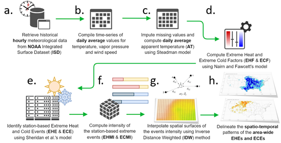

## Grid-based measures of extreme heat and cold

```{=html}
<figure>
<video autoplay muted loop playsinline controls poster="media/gridex-impacted-areas-poster.jpg" style="width:100%;height:auto" aria-label="Animated maps of areas affected by extreme heat and cold events in the contiguous United States, by year, 2008 to 2022">
<source src="media/gridex-impacted-areas.mp4" type="video/mp4">
</video>
<figcaption>Cumulative annual areas affected by extreme heat and cold, 2008–2022.</figcaption>
</figure>
```

## What is GridEX?

GridEX (short for "[Grid]{.underline}ded [EX]{.underline}posure") is a grid-based measure of exposure to extreme environmental events, specifically extreme heat and cold events, with a high spatial resolution of 500 × 500 m for the contiguous United States, spanning from 2008 to 2022. GridEX leverages a data science pipeline to gather station-based climatological data and estimate fine-resolution surfaces of ambient temperature which takes into account humidity and wind in addition to the actual air temperature.

## Methods

GridEX was developed through a sequential processes that involved compiling high-resolution spatio-temporal measures of extreme heat and cold factors. This method is depicted in the informatics diagram below and outlined as follows:

{fig-alt="GridEX Informatics Diagram" fig-align="center" width="500"}

1.  **Data Acquisition:** A dataset comprising over 800 million historical records of hourly and sub-hourly ambient temperature, dew point, and wind speed, recorded at nearly 2,250 weather stations, was retrieved, as provided by NOAA (Step a).

2.  **Daily meteorological parameters computation**: The daily average values for ambient temperature, vapor pressure, and wind speed were computed by taking the mean of hourly and sub-hourly raw data at station locations (Step b).

3.  **Missing data imputation**: Missing daily records of up to five days gap in the daily time series were detected and imputed based on the historical data from the same location (Step c).

4.  **Apparent temperature computation**: The average daily [apparent temperature (AT)](./posts/what_is_at.html "What is AT?")for each station was calculated using the method developed by Steadman (Step c).

5.  **Excess heat and cold factor computation**: The delineation of extreme events began by determining the excess heat and cold factors (EHF/ECF) as measures of temperature anomaly against historical normals (Step d). Anomalies were identified by contrasting the rolling average AT of the immediate past three days with the rolling average AT observed during the 30 days leading up to those three days at each station location.

6.  **Station-based extreme events identification**: Using the EHF/ECF, instances of extreme heat and cold events at the station locations were identified using relative thresholds according to Sheridan et al. (Step e).

7.  **Extreme events intensity measurement**: The intensity of these extreme events was quantified using the station-based EHE/ECE daily records by multiplying the duration of extreme heat or cold episodes and their levels of excess heat and cold. Following the suggestion by Fard et al., the resulting Extreme Heat and Cold Magnitude Indicators (EHMI/ECMI) were used to quantitatively compare the strength of EHE/ECE across geographies, where values closer to zero indicate locations minimally impacted by short-lived extreme conditions, whereas values approaching +100 pinpoint prolonged heat events, and those nearing -100 signify places affected by extended cold events (Step f).

8.  **Spatial interpolation**: Based on the intensity values derived for station locations, EHMI/ECMI values were spatially interpolated across the contiguous United States using the inverse distance weighted (IDW) method over a high-resolution spatial grid (Step g). The IDW method was employed to assign weights to nearby stations’ measurements (i.e., EHMI/ECMI) inversely proportional to their distances to each grid cell, and the weighted values were then averaged to estimate the EHMI/ECMI values for every grid cell, generating the continuous surface.

9.  **Area-wide extreme events determination**: By analyzing the interpolated grids of EHMI/ECMI, the geographic extent of extreme events was outlined and cataloged (Step h).

## Accuracy

The validation of GridEX surface estimates was performed using [GridMET](https://www.climatologylab.org/gridmet.html), as an externally validated reanalysis dataset. Both GridEX and GridMET share similar spatial and temporal characteristics, and comparison of ambient temperature readings at the station level with estimates from both grids showed that GridEX outperforms GridMET, by consistent improvements in R² values. Specifically, over the period from 2008 to 2022, during which the GridEX data is available, there was an increase in the median R² improvement from 1.5% to 3.5% in analyses conducted across nine separate state-level samples.

## Limitations

-   GridEX might not effectively represent temperature fluctuations at geographic scales smaller than 500x500 meters, such as the microclimates found in densely populated urban areas.

-   [GridMET's](https://www.climatologylab.org/gridmet.html) estimates were generated using inverse distance weighted (IDW) interpolation based on the assumption of flat planar terrains, and do not account for topographic variations.

-   Uncertainties arising from measurement inaccuracies and IDW model specifications can be further addressed using additional data sources, such as satellite-derived land surface temperature.

# Access the Datasets

Users can load the curated catalog of extreme events as well as the spatial layers of impacted areas into their pipeline in multiple ways. The GridEX's raster layers are delivered as gridded data in GeoTiff format, and the vector layers of EHE/ECE boundaries are provided as [GeoPackage](https://www.geopackage.org) files. This repository also includes the curated spatial dataset of daily mean TMP, DEW, WND, and AT offered in GeoPackage vector format.

## Spatial Catalog

[Spatial Catalog of the Extreme Heat and Cold Events in the U.S.](https://dataverse.harvard.edu/dataset.xhtml?persistentId=doi:10.7910/DVN/DJGKDJ)

## Interactive Catalog

We have also developed an app to explore the catalog of daily events and to visualize the aggregate statistical summaries of the events. The app is publicly accessible at: [Interactive Catalog of the Extreme Heat and Cold Events in the U.S.](https://ehce.connect.hms.harvard.edu/us_ehe_ece)

Users can process these pre-computed EHE/ECE dataset using standard workstations equipped with 8 cores and 16 GB of memory.

# License and Citation

The GridEX data set and the binding software scripts are released under the open-source MIT license. To cite the method, use the paper:

Fard P, Hügel J, Conte Keivabu R, Dominici F, Zagheni E, Estiri H, Patel CJ. Developing a spatiotemporal repository of extreme heat and cold exposure in the United States for precision public health research. *Environmental Science & Technology.* 2025;59(37):19872–19884. [doi:10.1021/acs.est.5c03658](https://doi.org/10.1021/acs.est.5c03658)

To cite the dataset:

Fard, Pedram; Patel, Chirag J.; Estiri, Hossein, 2023, "Spatial Catalog of the Extreme Heat and Cold Events in the U.S.", <https://doi.org/10.7910/DVN/DJGKDJ>, Harvard Dataverse.

### Data processing and issue tracker on Github

[GitHub](https://github.com/epedram/us_ehe_ece)

### Acknowledgements

This research has been funded by grants from the National Institutes of Health, National Institute on Aging (NIA) RF1AG074372, continued as R01AG074372, and National Institute of Environmental Health Sciences (NIEHS). Portions of computation for this research were conducted on the O2 High Performance Compute Cluster, supported by the [Research Computing Group at Harvard Medical School](https://it.hms.harvard.edu/our-services/research-computing). See for more information.

## Frequently asked questions

**What is GridEX?**
GridEX, short for Gridded EXposures, is an open dataset of extreme heat and cold events for the contiguous United States. It provides daily apparent temperature together with the boundaries and intensity of extreme heat and cold events on a 500 × 500 m grid from 2008 to 2022.

**How is GridEX built?**
GridEX draws on about 2,250 weather stations in the NOAA Integrated Surface Database and more than 800 million station records. Apparent temperature combines air temperature, humidity, and wind speed. Extreme events are detected at each station, scored with the Extreme Heat and Cold Magnitude Indicators (EHMI and ECMI), and interpolated across the grid by inverse distance weighting. The surfaces were validated against station observations and GridMET reanalysis data.

**How do I download GridEX?**
The rasters (GeoTIFF) and event boundaries (GeoPackage) are on [Harvard Dataverse](https://doi.org/10.7910/DVN/DJGKDJ) under the MIT license. The processing code is on [GitHub](https://github.com/epedram/us_ehe_ece), and an [interactive catalog](https://ehce.connect.hms.harvard.edu/us_ehe_ece) lets you browse events by date and place.

**Can GridEX be linked to health data?**
Yes. Because the output is gridded, GridEX joins to residential addresses, clinic locations, census tracts, counties, or any other geography. A [national study of 4.2 million ambulatory encounters](posts/ochin_jama_netw_open_2026.qmd) in community health centers used GridEX to measure exposure to extreme heat at each clinic.

**How do I cite GridEX?**
Cite the method paper, Fard et al., *Environmental Science & Technology* 2025 ([doi:10.1021/acs.est.5c03658](https://doi.org/10.1021/acs.est.5c03658)), and the dataset on Harvard Dataverse ([doi:10.7910/DVN/DJGKDJ](https://doi.org/10.7910/DVN/DJGKDJ)).

**Is GridEX related to the GridEx grid security exercise?**
GridEX here refers to the Gridded EXposures dataset of extreme heat and cold events developed by the Confluence Projects. The similarly named GridEx is a biennial grid security exercise run by the North American Electric Reliability Corporation, and the two are unrelated.
