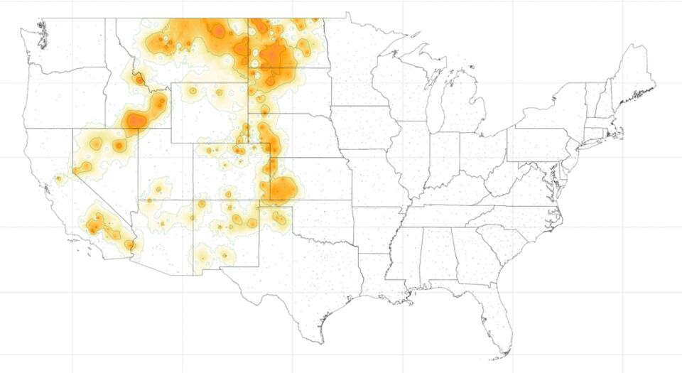

GridEX gives each 500 m cell in the contiguous United States a daily record of apparent temperature and of extreme heat and cold events from 2008 to 2022. The repository is open, and studies in community health centers, aging research, and population science now build on it. Using GridEX still requires a geographic information system, a working knowledge of raster and polygon formats, and code that joins exposure surfaces to the places where people live and receive care.

The questions that matter for health are compound. A network of community health centers may want to know which of its clinics sat inside an extreme heat event for three or more consecutive days, how often that happened over a decade, and which patients those clinics serve. Each part of that question is answerable from GridEX today, yet assembling the full answer takes an analyst days of work. This post describes where we are taking GridEX next: an AI layer that turns questions like these into transparent, reproducible queries and supports the decisions made on the answers.

## From a question to a query

```{=html}
<figure class="ai-fig" aria-labelledby="fig1-cap">
  <div class="flow" id="flow">
    <div class="flow-node" style="--i:0">
      <span class="flow-k">Question</span>
      <span class="flow-v">Which clinics sat inside an extreme heat event for three or more days in July 2022?</span>
    </div>
    <div class="flow-link" aria-hidden="true"><span></span></div>
    <div class="flow-node" style="--i:1">
      <span class="flow-k">Query plan</span>
      <span class="flow-chips"><em>place</em><em>period</em><em>event definition</em><em>facilities</em></span>
    </div>
    <div class="flow-link" aria-hidden="true"><span></span></div>
    <div class="flow-node flow-gridex" style="--i:2">
      <span class="flow-k">GridEX</span>
      <span class="flow-v">Daily surfaces and event boundaries on a 500 m grid</span>
    </div>
    <div class="flow-link" aria-hidden="true"><span></span></div>
    <div class="flow-node" style="--i:3">
      <span class="flow-k">Answer</span>
      <span class="flow-v">Maps, tables, and the code that produced them</span>
    </div>
  </div>
  <figcaption id="fig1-cap"><strong>Figure 1.</strong> The language model translates a question into a structured query plan. The computation runs on GridEX itself, and the answer returns with its code.</figcaption>
</figure>
```

A large language model is well suited to one narrow task here: translating a question written in plain language into a structured query. The model identifies four components in each question, namely the place, the period, the definition of an extreme event, and the population or facilities of interest. It then composes a query against the GridEX surfaces and event boundaries and returns the result together with the code that produced it. Because the computation runs on GridEX, each number in an answer traces back to the repository and can be rerun outside the assistant.

## What an answer looks like

```{=html}
<figure class="ai-fig" aria-labelledby="fig2-cap">
  <div class="ask" id="ask">
    <div class="ask-q">
      <span class="ask-label">Question</span>
      <p id="ask-text" aria-live="off">Where did extreme heat persist across the West and Northern Plains in mid-July 2022, and how did the affected area change from day to day?</p>
    </div>
    <div class="ask-plan">
      <span class="ask-label">Query plan</span>
      <ul class="ask-chips" id="ask-chips">
        <li><b>Place</b> Contiguous United States</li>
        <li><b>Period</b> 15 to 19 July 2022, daily</li>
        <li><b>Event</b> Extreme heat, EHMI above 0</li>
        <li><b>Output</b> Daily event extent and affected area</li>
      </ul>
    </div>
    <div class="ask-answer">
      <div class="ask-map">
        
      </div>
      <div class="ask-meta">
        <span class="ask-day" id="ask-day">17 July 2022</span>
        <div class="ask-steps" id="ask-steps" role="group" aria-label="Choose a day">
          <button type="button" data-day="15">15</button><button type="button" data-day="16">16</button><button type="button" data-day="17" aria-pressed="true">17</button><button type="button" data-day="18">18</button><button type="button" data-day="19">19</button>
        </div>
        <button type="button" class="map-toggle" id="ask-replay">Replay</button>
      </div>
      <p class="ask-returned"><span class="ask-label">Returned with</span> daily extent maps, a table of affected area by state, the event definition applied, and R code to reproduce each result.</p>
    </div>
  </div>
  <figcaption id="fig2-cap"><strong>Figure 2.</strong> Illustration of the planned interface. The maps are GridEX output for 15 to 19 July 2022; select a day to step through the event.</figcaption>
</figure>
```

Figure 2 walks through one question, from the plain-language request to the returned result. The assistant restates the question as a query plan, which the user can inspect and correct before anything runs. Its answer arrives as a daily sequence of event extents, a summary table, and the code needed to reproduce both. Extreme events are defined by thresholds, so the assistant also reports the definition it applied, and two users who ask similar questions receive comparable answers.

## From answers to decisions

Querying GridEX is the first step toward a larger goal, which is better decisions by the people who carry the burden of extreme environmental events. Community health centers plan staffing, outreach, and medication review around the days their patients are most exposed. Public health departments choose where to open cooling centers and whom to contact first, and investigators design studies around exposure contrasts that GridEX can quantify before any health data are requested.

Our [study of 4.2 million ambulatory encounters](ochin_jama_netw_open_2026.qmd) in community health centers shows why the details matter. Blood pressure fell slightly on extreme heat days, and the reductions were larger in adults 65 and older. Evidence of this kind informs planning once a clinic can ask how often its own patients faced those conditions. An AI layer over GridEX will shorten the path to that answer from weeks of analysis to one working session.

## The roadmap

```{=html}
<figure class="ai-fig" aria-labelledby="fig3-cap">
  <ol class="roadmap">
    <li class="rm-stage rm-now">
      <span class="rm-when">Available now</span>
      <h3>Open data</h3>
      <p>GridEX surfaces and event boundaries on Harvard Dataverse, an interactive catalog of extreme heat and cold events, and tutorials in R.</p>
    </li>
    <li class="rm-stage rm-next">
      <span class="rm-when">Next</span>
      <h3>Conversational querying</h3>
      <p>Plain-language questions translated into inspectable query plans, with maps, tables, and reproducible code returned together.</p>
    </li>
    <li class="rm-stage rm-later">
      <span class="rm-when">Envisioned</span>
      <h3>Decision support for planning</h3>
      <p>Summaries of the historical burden of extreme environmental events by facility, neighborhood, and population, with added exposure domains such as air pollution and an uncertainty estimate attached to each result.</p>
    </li>
  </ol>
  <figcaption id="fig3-cap"><strong>Figure 3.</strong> Three stages of GridEX development. The marker shows where the work stands today.</figcaption>
</figure>
```

Three commitments will guide this work. (1) Each answer will carry the query and code that produced it, so results can be audited and reproduced. (2) Each estimate will state its event definition, spatial resolution, and uncertainty. (3) GridEX will remain open, and the query layer will build on the public repository so that other teams can extend it.

We are looking for partners among health systems, community health center networks, and public health agencies who want to test these tools on their own questions. Members of the [team](../team.qmd) welcome inquiries from groups that want to shape the first version of these tools.

```{=html}
<script>
(function () {
  var reduce = window.matchMedia && window.matchMedia('(prefers-reduced-motion: reduce)').matches;
  var flow = document.getElementById('flow');
  if (flow && !reduce) flow.classList.add('is-animated');

  var img = document.getElementById('ask-img');
  var dayLabel = document.getElementById('ask-day');
  var steps = document.querySelectorAll('#ask-steps button');
  var chips = document.querySelectorAll('#ask-chips li');
  var text = document.getElementById('ask-text');
  var replay = document.getElementById('ask-replay');
  var box = document.getElementById('ask');
  if (!img || !box) return;
  var full = text.textContent;
  var timers = [];
  function later(fn, ms) { timers.push(setTimeout(fn, ms)); }
  function clear() { timers.forEach(clearTimeout); timers = []; }
  function show(day) {
    img.src = 'img/ask-gridex/day' + day + '.jpg';
    dayLabel.textContent = day + ' July 2022';
    steps.forEach(function (b) { b.setAttribute('aria-pressed', b.dataset.day === String(day) ? 'true' : 'false'); });
  }
  steps.forEach(function (b) { b.addEventListener('click', function () { clear(); finish(); show(b.dataset.day); }); });
  function finish() {
    text.textContent = full;
    chips.forEach(function (c) { c.classList.add('on'); });
    box.classList.add('answered');
  }
  function play() {
    clear();
    box.classList.remove('answered');
    chips.forEach(function (c) { c.classList.remove('on'); });
    text.textContent = '';
    var i = 0;
    (function type() {
      text.textContent = full.slice(0, i);
      if (i++ < full.length) later(type, 18);
      else {
        chips.forEach(function (c, k) { later(function () { c.classList.add('on'); }, 350 * (k + 1)); });
        later(function () {
          box.classList.add('answered');
          [15, 16, 17, 18, 19].forEach(function (d, k) { later(function () { show(d); }, 1100 * k); });
        }, 350 * (chips.length + 1));
      }
    })();
  }
  replay.addEventListener('click', function () { if (reduce) { finish(); show(15); } else play(); });
  if (reduce) { finish(); return; }
  var seen = false;
  var io = new IntersectionObserver(function (es) {
    es.forEach(function (e) { if (e.isIntersecting && !seen) { seen = true; play(); } });
  }, { threshold: 0.35 });
  io.observe(box);
  [15, 16, 18, 19].forEach(function (d) { var p = new Image(); p.src = 'img/ask-gridex/day' + d + '.jpg'; });
})();
</script>
```
