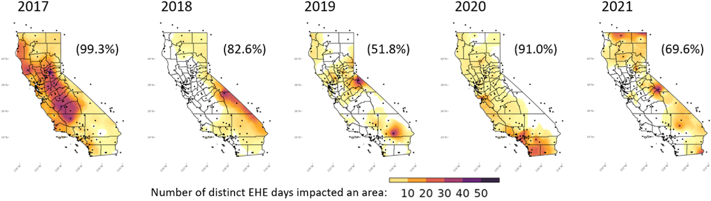

Fard P, Chung MKJ, Estiri H, Patel CJ. **Spatio-temporal interpolation and delineation of extreme heat events in California between 2017 and 2021.** *Environ Res.* 2023;237(Pt 2):116984. [doi:10.1016/j.envres.2023.116984](https://doi.org/10.1016/j.envres.2023.116984)

Code: [github.com/epedram/ehmi](https://github.com/epedram/ehmi)

This paper laid the groundwork for [GridEX](../gridex.qmd), which extends the same approach to the contiguous United States.

## Summary

Studying how extreme heat affects health requires accurately identifying the areas and people it reaches. Usually, researchers estimate these conditions using data from the nearest weather station, but this method can be inaccurate. A new approach has been developed that better tracks Extreme Heat Events by using a more detailed temperature measure. This improved method is much more precise, correctly identifying about one million more Californians affected by severe heat each day between 2017 and 2021, compared to the old way.

## Highlights

-   Our proposed method uses spatial interpolation to accurately estimate EHE boundaries.

-   The conventional methods rely on absolute temperature and larger spatial scales.

-   Our method accounts for antecedent temperature conditions and composite heat measure.

-   Our method significantly reduces misclassification of populations impacted by EHEs.

### Overview

{fig-align="center"}

{fig-align="center"}

{fig-align="center"}
