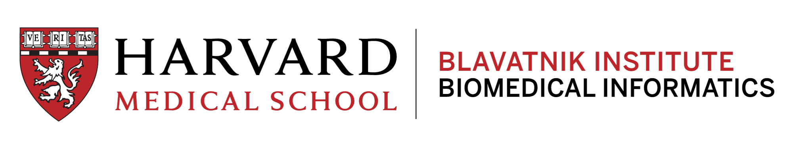

## Investigators and staff

::: {#members}
:::

## Collaborators

OCHIN
:   Rachel Gold, Karen Albright, and Brenda McGrath, Community CATALYST Center

Max Planck Institute for Demographic Research
:   Riccardo Conte Keivabu and Emilio Zagheni

Technical University of Denmark
:   Jonas Hügel

## Institutes

|                                                   |                                |
|---------------------------------------------------|--------------------------------|
| {width="300"} | {width="500"} |
| {fig-alt="Massachusetts General Hospital"} |               |

## Support

{width="200" height="56"}

-   National Institute on Aging: [RF1AG074372](https://reporter.nih.gov/project-details/10448053) (2022–2025), continued as R01AG074372 (Patel, Estiri, and Dominici)
-   National Institute on Minority Health and Health Disparities: [P20MD019799](https://reporter.nih.gov/project-details/10977025), Community CATALYST Center with OCHIN (Gold, Albright, and Estiri)
